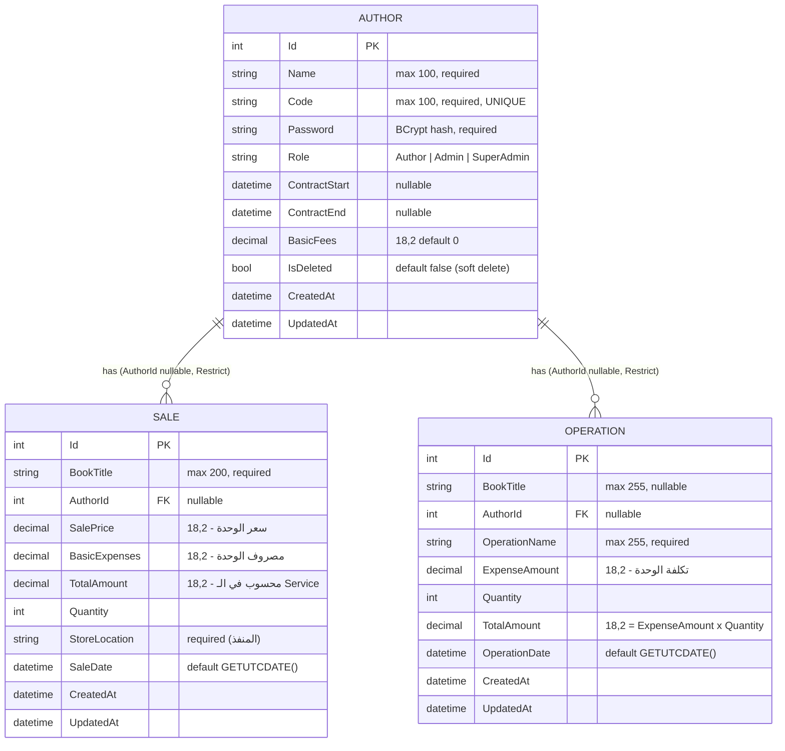
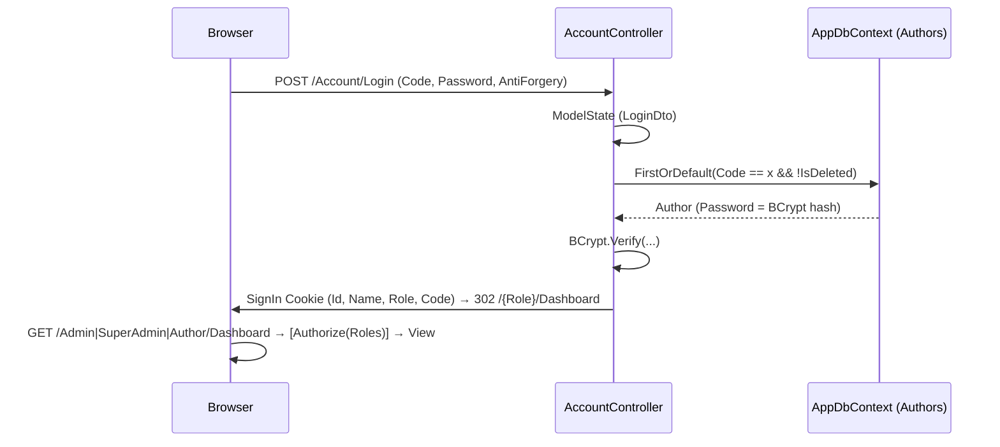
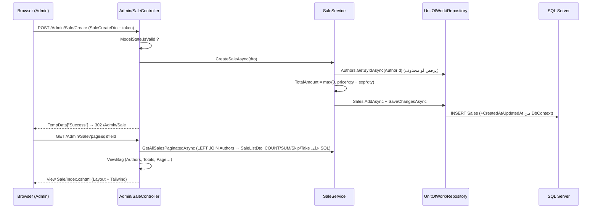
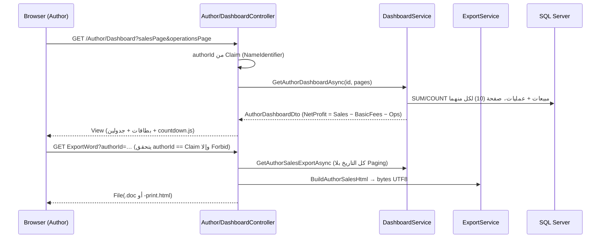

# PROJECT_ANALYSIS — AlAsma.Admin (الأسمى للنشر والتوزيع)

> تحليل للقراءة فقط (Read-only) — لم يتم تعديل أي كود. مبني على قراءة الكود الفعلي بتاريخ 2026-10-26 (آخر commit: `00f7103 LoclDB`).
> **ملاحظة صدق:** الـ Controllers / Services / Models / DTOs / Program.cs / Layout / Navbar اتقرأت كاملة سطر بسطر. ملفات الـ Views الكبيرة (Sale/Index, Operation/Index, Dashboards…) اتفحصت بالـ grep (الأعمدة، الأكشنز، الألوان، السكريبتات) وليس سطر بسطر.

---

## تحديث الحالة (2026-10-26) — ما اتصلح فعلاً

| البند | الحالة |
|---|---|
| صلاحيات الأدمن (لا حذف، لا تعديل مؤلفين، لا Bulk) | ✅ اتطبق (Controller + إخفاء الأزرار) |
| الـ Views تعرض `TotalAmount` من الـ DB بدل حسابها | ✅ |
| ترتيب Seeder/Migrate + try/catch | ✅ |
| Pagination: `page <= 0` | ✅ (Author + Sale) |
| ثغرة `System.Security.Cryptography.Pkcs 9.0.4` (High) | ✅ اتصلحت (إصدار 10.0.14 مباشر) — `dotnet list package --vulnerable` نظيف |
| تحديث الباكجات: EF Core 10.0.14، BCrypt 4.2.0، `dotnet-ef` 10.0.14 | ✅ |
| ترميز HTML للتقارير (منع الحقن) | ✅ |
| Rate limiting على الدخول (8/دقيقة لكل IP) | ✅ اتجرب: 429 بعد 8 محاولات |
| إعادة التحقق من المستخدم في كل طلب (حذف/تغيير دور) | ✅ اتجرب: الحساب المحذوف يخرج فوراً |
| سياسة افتراضية "لازم تسجيل دخول" + `[AllowAnonymous]` للصفحات العامة | ✅ |
| كوكي HttpOnly/SameSite + ترويسات أمان | ✅ |
| حد أدنى لكلمة المرور في التعديل (6) | ✅ |
| كود مؤلف محذوف لا يُعاد استخدامه (500 سابقاً) | ✅ |
| `UpdateSale`: التحقق من المؤلف | ✅ |
| Bulk Edit: التحقق من القيمة + تحديث `UpdatedAt` | ✅ |
| **PDF حقيقي** (QuestPDF) لتقرير المؤلف والمبيعات والعمليات + أزرار PDF في الواجهة | ✅ اتجرب |

**لسه مفتوح:** كلمة سر الداتابيز في `appsettings.json` (قرارك: تتغير)، Tailwind من CDN، لوجو 1.5MB، سياسة CSP، ثوابت/Enums للأدوار، اختبارات آلية، Audit Log. الـ Clamp عند 0 وتعدد صيغ الربح **مقصودين** (طلب العميل).

> ملاحظة PDF: QuestPDF 2026.9 لم تعد تستخدم خطوط النظام تلقائياً، فضبطنا `UseSystemFonts=true` (Arial/Tahoma على Windows). لو الاستضافة بدون هذه الخطوط، ضع ملف خط عربي (مثل Cairo) في مجلد `Fonts` بجوار التطبيق. ترخيص QuestPDF Community مجاني للجهات تحت حد إيرادات محدد — راجع شروطه.

---

## 0. أهم 8 نقاط (اقرأ دي لو معاك دقيقة)

1. **المشروع أصلاً على .NET 10 بالفعل** (`net10.0`، `EF Core 10.0.3`، `dotnet-ef 10.0.5`) — مش .NET 9. لو ناوي "تحديث من 9 إلى 10" فالتحديث ده **متعمل** في الـ csproj. اللي ناقص هو مراجعة باقي الباكجات والـ libs (انظر §2).
2. **كلمة سر قاعدة البيانات الحقيقية (Host + User + Password) مكتوبة في `appsettings.json` ومعمول لها commit في git.** لازم تتغير (Rotate) فوراً وتتنقل لـ user-secrets / environment variables. (مش هكررها هنا.)
3. **مفيش "كيان كتاب" (Book)**. اسم الكتاب نص حر داخل `Sale` و`Operation`. مفيش مخزون ولا ISBN ولا نسبة Royalty. "أرباح المؤلف" = صافي مبيعات − مصاريف أساسية − عمليات. (مفصل في §6.)
4. **فيه 3 تعريفات مختلفة لـ"صافي الربح/الإيراد"** في 3 شاشات (Dashboard إجمالي خام / Sales صافي بعد المصروفات / Operations إجمالي − مصاريف). الأرقام مش بتتطابق. (§6.6)
5. **الـ "PDF" مش PDF** — هو ملف HTML للطباعة، و"Word" هو HTML بامتداد `.doc`. ومفيش HTML-encoding للبيانات داخل التقارير.
6. **الواجهة كلها Tailwind من CDN (`cdn.tailwindcss.com`)** + Google Fonts (Cairo) + Material Icons — محتاجة إنترنت، وTailwind CDN مش للـ production. ملفات CSS الستة في `wwwroot/css` **غير مستخدمة تقريباً** (واحد بس `shared.css` في صفحة AccessDenied).
7. **ترتيب الـ Startup غلط:** الـ Seeder بيشتغل **قبل** `Database.Migrate()` (على DB فاضية هيفشل ويوقع التطبيق).
8. **الـ Author/Admin/SuperAdmin كلهم في جدول واحد `Authors`** والدور نص (`"Author"/"Admin"/"SuperAdmin"`) مكرر كـ string literals في كل الكود.

---

## 1. Project overview

**الفكرة:** لوحة إدارة (Admin Panel) لدار نشر وتوزيع كتب: إدارة المؤلفين وعقودهم، تسجيل مبيعات الكتب يدوياً، تسجيل مصروفات/عمليات تشغيلية، متابعة الإيراد وصافي الربح، تصدير تقارير، ولوحة خاصة لكل مؤلف يشوف فيها مبيعاته وصافي ربحه.

**اللغة/الاتجاه:** واجهة عربية RTL بالكامل، العملة "ج.م" (جنيه مصري). النصوص مكتوبة hard-coded في الكود والـ Views (مفيش Localization/Resources).

**المستخدمون (3 أدوار):**

| الدور | مين هو | بيعمل إيه |
|---|---|---|
| **SuperAdmin** | صاحب النظام (يتعمل بالـ Seeder من config) | يدير الـ Admins + كل صلاحيات الـ Admin |
| **Admin** | موظف/مدير الدار | يدير المؤلفين، المبيعات، العمليات، يشوف الداشبورد ويصدّر التقارير |
| **Author** | المؤلف | يشوف مبيعاته وعقده وصافي ربحه فقط، ويصدّر تقريره |

> لا يوجد تسجيل ذاتي (Self-registration). كل الحسابات بيعملها SuperAdmin (Admins) أو Admin/SuperAdmin (Authors). الدخول بـ **Code + Password** (مش email).

**حالة المشروع:** 12 commit فقط (من 2026-03-22 إلى 2026-04-16)، مفيش tests، مفيش CI. مستضاف على Host ASP.NET مشترك (الـ DB على `databaseasp.net`).

---

## 2. Tech stack & NuGet packages

| العنصر | القيمة |
|---|---|
| Framework | ASP.NET Core MVC (`Microsoft.NET.Sdk.Web`), **`net10.0`**, Nullable + ImplicitUsings enabled |
| Solution | `AlAsma.Admin.slnx` (الصيغة الجديدة XML) |
| ORM / DB | EF Core 10.0.3 + SQL Server |
| Auth | Cookie Authentication (8 ساعات، Sliding) + Role-based `[Authorize(Roles=…)]` |
| Hashing | BCrypt.Net-Next 4.1.0 (default work factor) |
| Views | Razor + Areas (Admin / Author / SuperAdmin) |
| Front-end | Tailwind (CDN, JIT في المتصفح)، Cairo font (Google Fonts)، Material Icons Round، jQuery + jquery-validation(-unobtrusive) من `wwwroot/lib`، Bootstrap داخل `wwwroot/lib` **لكن غير مستخدم** في الـ Layout |
| Tools | `dotnet-ef` 10.0.5 (`rollForward: false`) |

**NuGet packages (من الـ csproj):**

| Package | Version | ملاحظة |
|---|---|---|
| `BCrypt.Net-Next` | 4.1.0 | راجع أحدث إصدار |
| `Microsoft.EntityFrameworkCore` | 10.0.3 | |
| `Microsoft.EntityFrameworkCore.SqlServer` | 10.0.3 | |
| `Microsoft.EntityFrameworkCore.Tools` | 10.0.3 | `PrivateAssets=all` |
| (dotnet tool) `dotnet-ef` | 10.0.5 | الإصدار مختلف عن الباكجات (10.0.3) — وحّدهم |

> **للتحديث:** وحّد إصدارات EF (10.0.3 vs tool 10.0.5)، راجع إصدارات jQuery / jquery-validation / Bootstrap في `wwwroot/lib` (إصداراتها مش متسجلة في الـ csproj — بتتحدث يدوياً)، وفي `<ItemGroup><Folder Include=…>` كتير زيادة في الـ csproj ممكن تتشال.
> أيضاً `Program.cs` بيستخدم `UseStaticFiles()` **و** `MapStaticAssets()` مع بعض (كفاية واحد في .NET 9+/10).

**Configuration (`appsettings*.json`):** `ConnectionStrings:DefaultConnection` (إجباري — التطبيق يرمي exception لو فاضي)، `SuperAdmin:{Name,Code,Password}` (للـ Seeder — موجود في `appsettings.Example.json` كـ placeholders)، Logging، `AllowedHosts: *`. فيه `UserSecretsId` في الـ csproj (يعني user-secrets مجهز بس مش مستخدم فعلياً — الـ secret الحقيقي في الملف).

**Launch:** `http://localhost:5133` / `https://localhost:7165`.

---

## 3. Folder structure & layers

```
AlAsma.Admin/                      (repo root)
├─ AlAsma.Admin.slnx
├─ README.md                       (مرجع عربي سريع)
├─ SYSTEM_FEATURES_AND_SCALABILITY.md   (untracked — حصر + خطة متجر كتب)
└─ AlAsma.Admin/                   (المشروع)
   ├─ Program.cs                   DI + Auth + Seed + Migrate + Pipeline + Routes
   ├─ Models/                      Entities: BaseEntity, Author, Sale, Operation (+ ErrorViewModel غير مستخدم)
   ├─ Data/
   │   ├─ AppDbContext.cs          Fluent config + Query Filter + auto CreatedAt/UpdatedAt
   │   ├─ Seeder/SuperAdminSeeder  ينشئ SuperAdmin من config (يرفض القيم الـ placeholder)
   │   └─ Migrations/              InitialCreate (2026-03-22), AddOperationsTable (2026-04-04)
   ├─ Interfaces/                  IRepository<T>, IUnitOfWork, IAuthorService, ISaleService,
   │                               IOperationService, IDashboardService, IExportService
   ├─ Repositories/                GenericRepository<T>, UnitOfWork
   ├─ Services/                    AuthorService, SaleService, OperationService,
   │                               DashboardService, ExportService   ← business logic
   ├─ DTOs/                        Auth, Author, Sale, Operation, Dashboard
   ├─ Controllers/                 AccountController (Login/Logout/AccessDenied), ErrorController
   ├─ Areas/
   │   ├─ SuperAdmin/ (Controllers: Dashboard, AdminManagement + Views)
   │   ├─ Admin/      (Controllers: Dashboard, Author, Sale, Operation + Views)
   │   └─ Author/     (Controllers: Dashboard + View)
   ├─ Views/Shared/                _Layout, _Navbar, _Footer, _Notifications, Error, _ValidationScriptsPartial
   ├─ Views/Account/               Login, AccessDenied, (Index + Privacy = بقايا قالب)
   └─ wwwroot/                     css/ (6 ملفات), js/ (countdown.js, site.js فاضي), images/logo.png,
                                   favicon.ico, lib/ (bootstrap, jquery, jquery-validation[-unobtrusive])
```

**دور كل طبقة (والواقع الفعلي):**

| الطبقة | الدور | الملاحظة |
|---|---|---|
| Controllers | استقبال الطلب، ModelState، TempData، redirects | تسرب منطق: `SaleController.BulkEditExpenses` فيه Query + صيغة حساب مباشرة، و`AdminManagementController` بيتعامل مع `IUnitOfWork` مباشرة وبيعمل Author بنفسه، و`AccountController` بيستخدم `AppDbContext` مباشرة |
| Services | منطق الأعمال + Projection لـ DTO | جيدة نسبياً (Queries تتنفذ على SQL) |
| Repository/UoW | تجريد فوق EF | **طبقة رقيقة جداً** (Generic فقط) و`Query()` بيرجع `IQueryable` — يعني التجريد فعلياً مكشوف |
| Data | DbContext + Migrations + Seeder | |
| DTOs | ViewModels / Input models | |

---

## 4. Entities, relationships & constraints

### 4.1 ERD



### 4.2 Key constraints & behaviors

| الموضوع | التفاصيل |
|---|---|
| **BaseEntity** | `Id`, `CreatedAt`, `UpdatedAt` — بيتضبطوا تلقائياً في `AppDbContext.SaveChangesAsync` (Added → الاتنين، Modified → `UpdatedAt` فقط و`CreatedAt` متحمي). **تنبيه:** `ExecuteUpdateAsync` (Bulk Edit) بيتخطى ده فـ `UpdatedAt` مش بيتحدث. والـ override على `SaveChangesAsync` فقط (مش النسخة المتزامنة). |
| **Unique** | `Authors.Code` (Unique Index) — بيشمل المحذوفين soft. |
| **Soft delete** | Global Query Filter `!IsDeleted` على `Author`. المؤلف المحذوف يختفي من الـ Queries، وأي Sale/Operation مرتبطة بيه بتظهر "بدون مؤلف" (Left Join + الفلتر). |
| **FK** | `Sale.AuthorId` و`Operation.AuthorId` نوعهم `int?`، `OnDelete(Restrict)`. |
| **Defaults** | `SaleDate`, `OperationDate` = `GETUTCDATE()`، `BasicFees` = 0، `IsDeleted` = false. |
| **Precision** | كل الأموال `decimal(18,2)`. |
| **Annotations على Sale** | `SalePrice [Range(0.01..)]`, `BasicExpenses [Range(0..)]`, `Quantity [Range(1..)]` (بتتطبق على الـ Model لكن الفاليديشن الفعلي على الـ DTOs). |
| **Computed (غير مخزنة)** | `Author.ContractStatus`, `Author.DaysRemaining` ([NotMapped]) — ومكررة كمان في `AuthorService` و`DashboardService`. |
| **Indexes** | Unique(Code)، وIndex تلقائي على `AuthorId` في Sales/Operations. **مفيش** Index على `SaleDate`, `OperationDate`, `Role`, `BookTitle`. |
| **Not enforced** | مفيش CHECK على `Role`، مفيش RowVersion (Concurrency)، `StoreLocation`/`Password`/`Role` من غير MaxLength في الـ Entity (→ `nvarchar(max)`)، و`Code` أقصاه 100 في الـ Entity لكن 50 في الـ DTO. |

### 4.3 DTOs وفاليديشنها

| DTO | القواعد |
|---|---|
| `LoginDto` | Code (required, max 50), Password (required, max 100) |
| `AuthorCreateDto` | Name (required, 100), Code (required, 50), Password (required, **min 6**, max 100), BasicFees `[Range(0..)]` |
| `AuthorEditDto` | Name (required, 100), Password اختياري **بدون أي حد أدنى**, BasicFees `[Range(0..)]` |
| `SaleCreateDto` | BookTitle (required, 200), AuthorId `[Range(1..)]`, SalePrice `[Range(0.01..)]`, BasicExpenses `[Range(0..)]`, Quantity `[Range(1..)]`, StoreLocation (required, 200), SaleDate |
| `OperationCreateDto` | OperationName (required, 255), ExpenseAmount `[Range(0..)]`, Quantity `[Range(1..)]`, BookTitle (255), AuthorId? |

---

## 5. Controllers, routes & authorization

**Routes (Program.cs):**
1. `areas`: `{area:exists}/{controller=Dashboard}/{action=Index}/{id?}`
2. `default`: `{controller=Account}/{action=Login}/{id?}` ← الصفحة الرئيسية `/` = Login
3. `ErrorController` بـ attribute routing: `/Error` و`/Error/{statusCode:int}` (مربوط بـ `UseExceptionHandler("/Error")` و`UseStatusCodePagesWithReExecute("/Error/{0}")`).

الـ Authorization بيتحط **على مستوى الـ Controller** (`[Authorize(Roles=…)]`) — مفيش Policies ولا Fallback Policy؛ يعني أي Controller جديد من غير attribute يبقى **مفتوح**.

### 5.1 Account (بدون Area)

| Action | Verb / Route | Auth | الوظيفة |
|---|---|---|---|
| `Login` | GET `/` أو `/Account/Login` | AllowAnonymous | لو داخل بالفعل → redirect حسب الدور |
| `Login(LoginDto)` | POST | AllowAnonymous + AntiForgery | يدور على `Code` (غير محذوف) → `BCrypt.Verify` → Claims (`NameIdentifier`, `Name`, `Role`, `Code`) → Cookie دائم (`IsPersistent=true`) → redirect للداشبورد حسب الدور |
| `Logout` | POST + AntiForgery | (بدون `[Authorize]`) | SignOut → Login |
| `AccessDenied` | GET | (بدون attribute) | صفحة "غير مصرح" |
| `ErrorController.Index / StatusCodePage` | `/Error`, `/Error/{code}` | — | يعرض `Error.cshtml` (عنوان + رسالة عربي) |

### 5.2 Area `SuperAdmin` — `[Authorize(Roles="SuperAdmin")]`

| Controller | Action | Verb | الوظيفة |
|---|---|---|---|
| `Dashboard` | `Index` | GET | يستخدم نفس `GetAdminDashboardAsync()` ويعرض view الـ Admin (`~/Areas/Admin/Views/Dashboard/Index.cshtml`) — `Areas/SuperAdmin/Views/Dashboard/Index.cshtml` فاضي عمداً |
| `AdminManagement` | `Index` | GET | قائمة الـ Admins (تحمل كل `Authors` في الذاكرة وتفلتر) |
| | `Create` | GET/POST | ينشئ Admin (`Role="Admin"` ثابت، `Code.ToUpper()`)، يتحقق من تفرد الكود + يلتقط `DbUpdateException` |
| | `Edit` | GET/POST | تعديل الاسم/العقد/الرسوم/كلمة السر (لو اتبعتت) |
| | `Delete` | GET/POST | Soft delete (`IsDeleted=true`) |

### 5.3 Area `Admin` — `[Authorize(Roles="Admin,SuperAdmin")]` (كل الـ Controllers)

| Controller | Action | Verb | الوظيفة / الباراميترات |
|---|---|---|---|
| `Dashboard` | `Index` | GET | KPIs + آخر 5 مبيعات + المؤلفين اللي عقدهم قرب ينتهي |
| `Author` | `Index(page=1)` | GET | قائمة المؤلفين (Pagination 10) — بتستثني Admin/SuperAdmin |
| | `Create` | GET/POST | إضافة مؤلف (Role="Author")؛ كود مكرر → خطأ على حقل Code |
| | `Edit` | GET/POST | تعديل (الكود للعرض فقط) |
| | `Delete` | GET/POST(`DeleteConfirmed`) | Soft delete |
| `Sale` | `Index(page, q, field="book")` | GET | قائمة + بحث (`book/author/code/store`) + مجاميع + Pagination 10 + نماذج Create/Edit/BulkEdit في نفس الصفحة (Modals) |
| | `Create` | GET/POST | تسجيل بيع (GET له View مستقل، POST عند الفشل يرجع `Index`) |
| | `Edit` | POST | تعديل بيع (من Modal) |
| | `Delete` | GET/POST | **Hard delete** |
| | `BulkEditExpenses(q, field, newBasicExpenses)` | POST | يغيّر `BasicExpenses` لكل السجلات المطابقة للفلتر الحالي (أو **كل السجلات** لو الفلتر فاضي) ويعيد حساب `TotalAmount` في SQL |
| | `ByAuthor(authorId, salesPage, operationsPage)` | GET | نفس داشبورد المؤلف لكن يشوفه الأدمن |
| | `Export` | GET | كل المبيعات → `.doc` |
| | `ExportWordByAuthor(authorId)` | GET | تقرير مؤلف → `.doc` |
| | `ExportPdfByAuthor(authorId)` | GET | تقرير مؤلف → `.html` للطباعة |
| `Operation` | `Index(q, field="operation", page)` | GET | قائمة + بحث (`operation/book/author/code`) + KPIs |
| | `Create` / `Edit` | POST | من Modals؛ لو ModelState غلط → redirect + رسالة خطأ عامة (البيانات بتضيع) |
| | `Delete` | GET / POST(`DeleteConfirmed`) | **Hard delete** |
| | `Export` | GET | كل العمليات → `.doc` |

### 5.4 Area `Author` — `[Authorize(Roles="Author")]`

| Action | Verb | الوظيفة |
|---|---|---|
| `Dashboard/Index(salesPage, operationsPage)` | GET | بيانات المؤلف المسجل دخوله فقط (الـ id من الـ Claim، مش من URL) |
| `ExportWord(authorId)` / `ExportPdf(authorId)` | GET | بيقارن `authorId` بالـ Claim وإلا `Forbid()` ✔️ (حماية IDOR سليمة) |

---

## 6. Business logic per module (الصيغ زي ما هي في الكود)

> **ملحوظة مهمة:** مفيش Module باسم "Royalties" أو نسبة أرباح للمؤلف في الكود. أقرب شيء لـ"Author earnings" هو `NetProfit` في داشبورد المؤلف (§6.4). مفيش "Revenue module" مستقل — الإيراد بيتحسب داخل الـ Dashboards.

### 6.1 Sales (`SaleService`)

```csharp
// SaleService.CalculateTotal
revenue       = salePrice * quantity;
totalExpenses = basicExpenses * quantity;          // BasicExpenses = تكلفة الوحدة (طباعة/شحن…)
TotalAmount   = Math.Max(0, revenue - totalExpenses);   // مقصوص عند صفر (مفيش قيمة سالبة)
```

- **Create:** يتأكد إن المؤلف موجود وغير محذوف (`IsDeleted`)، يحسب `TotalAmount`، يحفظ `SaleDate` من الفورم.
- **Update:** يحدّث الاسم/المؤلف/المنفذ/السعر/الكمية/المصروفات ويعيد حساب `TotalAmount`. **لا يحدّث `SaleDate`** ولا يتحقق من وجود المؤلف الجديد.
- **Delete:** Hard delete بدون تأكيد على مستوى الـ Service.
- **Bulk Edit (Controller):** `ExecuteUpdate`:
  `BasicExpenses = newBasicExpenses` و `TotalAmount = max(0, SalePrice*Qty − newBasicExpenses*Qty)` (نفس الصيغة لكن مكررة في SQL). مفيش حد أدنى لـ `newBasicExpenses` (ممكن قيمة سالبة).
- **Sales page aggregates** (على الـ query المفلتر):
  - `TotalRevenue = Σ TotalAmount` ← **صافي بعد المصروفات**
  - `TotalExpenses = Σ (BasicExpenses × Quantity)`
  - `TotalQuantity = Σ Quantity`
  - `TotalCount = Count`
- **Search:** `ToLower().Contains(q)` على (BookTitle | AuthorName | AuthorCode | StoreLocation) — Case-insensitive، Pagination على SQL (`Skip/Take`)، ترتيب `SaleDate DESC, Id DESC`.
- `GetTotalSalesByAuthorAsync = Σ TotalAmount`، `GetNetProfitByAuthorAsync = Σ TotalAmount − Author.BasicFees` (لا يبدو مستخدماً في أي Controller).

### 6.2 Operations / Expenses (`OperationService`)

```csharp
TotalAmount = ExpenseAmount * Quantity;       // مفيش Clamp
OperationDate = DateTime.UtcNow;              // وقت الإنشاء، لا يتعدل
```

- `AuthorId` اختياري (نفقة عامة = بدون مؤلف). لو اتحدد يتأكد إنه موجود.
- `BookTitle` فاضي → `null` (وبيعرض "نفقة عامة").
- **Operations page KPIs:**
  ```csharp
  totalOpsExpenses   = Σ Operation.TotalAmount           // على الـ query المفلتر
  totalSalesExpenses = Σ (Sale.BasicExpenses * Sale.Quantity)   // على كل المبيعات (غير مفلتر!)
  TotalExpenses      = totalOpsExpenses + totalSalesExpenses
  TotalGrossSales    = Σ (Sale.SalePrice * Sale.Quantity)       // كل المبيعات (غير مفلتر)
  NetProfit          = TotalGrossSales − TotalExpenses
  ```
- Search: `EF.Functions.Like('%q%')` على (OperationName | BookTitle | AuthorName | AuthorCode).

### 6.3 Authors & Contracts (`AuthorService`, `Author` model)

```csharp
days = (ContractEnd - DateTime.UtcNow).TotalDays
ContractEnd == null → "غير محدد"
days <= 0           → "منتهي"
days <= 20          → "ينتهي قريباً"
else                → "نشط"
DaysRemaining = ContractEnd null ? null : max(0, (int)days)     // قص عشري (truncate)
```

- Create: كود فريد (يتأكد بـ `AnyAsync`)، Role="Author"، BCrypt للباسورد. (الـ Admin بيتعمل في `AdminManagementController` مع `ToUpper()` للكود — الـ Author **لا** يتحول لـ Upper.)
- Update: الاسم/العقد/الرسوم + الباسورد لو اتبعت. Role و Code لا يتغيروا.
- Delete: Soft delete. لا يمكن لخدمة المؤلفين لمس Admin/SuperAdmin.
- القائمة: `Role ∉ {SuperAdmin, Admin}`، `SalesCount` و`OperationsCount` كـ correlated subqueries، ترتيب `Id DESC`.
- `BasicFees` = **رسوم أساسية بتتخصم من المؤلف** (مبلغ ثابت على مستوى العقد) — وهي بتتخصم في صافي ربح المؤلف.

### 6.4 Author earnings (`DashboardService.GetAuthorDashboardAsync`)

```csharp
TotalSales         = Σ Sale.TotalAmount  (للمؤلف)         // صافي بعد مصروفات الوحدة
OperationsExpenses = Σ Operation.TotalAmount (للمؤلف)
NetProfit          = TotalSales − Author.BasicFees − OperationsExpenses     // ← "أرباح المؤلف"
SalesCount / OperationsCount = Count
Pagination: pageSize = 10 لكل من المبيعات والعمليات (مع Math.Max(1, page))
```

- بيشتغل على أي `authorId` (حتى لو Admin) — مفيش تحقق من الـ Role.
- لا يوجد Royalty % ولا أرصدة مدفوعة/مستحقة (Payments/Payouts).

### 6.5 Admin / SuperAdmin Dashboard (`GetAdminDashboardAsync`)

```csharp
TotalAuthors   = Count(Role == "Author")                      // غير المحذوفين (Query Filter)
TotalSales     = Count(Sales)                                  // عدد العمليات مش القيمة
TotalRevenue   = Σ (SalePrice * Quantity)                      // إجمالي خام (Gross) — مش TotalAmount
ActiveContracts     = Count(ContractEnd > now + 20d)
EndingSoonContracts = Count(now < ContractEnd <= now + 20d)
ExpiredContracts    = Count(ContractEnd <= now)                // ContractEnd == null → خارج الـ 3 عدادات
RecentSales = آخر 5 (SaleDate DESC, Id DESC)
ExpiringAuthors = المؤلفين اللي في فئة "ينتهي قريباً"
```

محسوبة في الـ View: `averageSaleValue = TotalRevenue / TotalSales` و `revenuePerAuthor = TotalRevenue / TotalAuthors` (مقربة لأقرب عدد صحيح)، ونسب العقود.
> كود `GetSuperAdminDashboardAsync` موجود لكنه **غير مستخدم** (والـ SuperAdmin Controller يستخدم Admin dashboard) — ويحمّل كل Authors وSales في الذاكرة.

### 6.6 ⚠️ تضارب الأرقام بين الشاشات

| الشاشة | "الإيراد" | "الربح" |
|---|---|---|
| Admin Dashboard | Σ SalePrice×Qty (خام) | — |
| Sales page | Σ TotalAmount (صافي بعد مصروف الوحدة، مقصوص عند 0) | — |
| Operations page | — | Σ(SalePrice×Qty) − (Σ ops + Σ BasicExpenses×Qty) — **بدون Clamp وبدون BasicFees المؤلفين** |
| Author dashboard | Σ TotalAmount | Σ TotalAmount − BasicFees − Σ ops |

- الـ Clamp `Math.Max(0, …)` بيخلي البيع الخاسر = 0 في صافي المؤلف، بينما شاشة Operations بتحسبه سالب.
- الـ KPIs في Operations بتخلط بيانات مفلترة (العمليات) بغير مفلترة (المبيعات).

### 6.7 Export (`ExportService`)

يولّد **سلسلة HTML** (RTL، Arial، ألوان `#064e3b` للمبيعات و`#ea580c` للعمليات) ويرجعها كملف:
- Word: `application/msword` وامتداد `.doc` (HTML في الحقيقة).
- "PDF": `text/html` باسم `…-print.html` (المستخدم يطبع من المتصفح).
البيانات بتتحط في الـ HTML **بدون Encoding** (`{s.BookTitle}` …).

---

## 7. User roles — صلاحيات كل دور

| القدرة | Author | Admin | SuperAdmin |
|---|:--:|:--:|:--:|
| تسجيل الدخول بالكود والباسورد | ✅ | ✅ | ✅ |
| داشبورد شخصي (مبيعاتي + عقدي + أرباحي) | ✅ (نفسه فقط) | — | — |
| تصدير تقريره (Word/Print) | ✅ (نفسه فقط) | — | — |
| Dashboard إدارة (KPIs + العقود) | ❌ | ✅ | ✅ |
| عرض قائمة المؤلفين وصفحة أي مؤلف (`Sale/ByAuthor`) + تصدير تقريره | ❌ | ✅ (عرض فقط) | ✅ |
| إضافة / تعديل / حذف مؤلف | ❌ | ❌ | ✅ |
| المبيعات: عرض + إضافة + تعديل | ❌ | ✅ | ✅ |
| المبيعات: حذف + التعديل الجماعي للمصروفات (Bulk) | ❌ | ❌ | ✅ |
| العمليات: عرض + إضافة + تعديل | ❌ | ✅ | ✅ |
| العمليات: حذف | ❌ | ❌ | ✅ |
| تصدير كل المبيعات / كل العمليات | ❌ | ✅ | ✅ |
| إدارة الـ Admins (CRUD) | ❌ | ❌ | ✅ |
| إنشاء/تعديل SuperAdmin | ❌ | ❌ | ❌ (بالـ Seeder فقط) |

> **تحديث 2026-10-26:** صلاحيات الأدمن اتضبطت حسب قرار العميل: الأدمن يدير الموقع (يشوف كل حاجة ويضيف ويعدّل مبيعات وعمليات) لكن **الحذف وتعديل/حذف المؤلفين والـ Bulk Edit للـ SuperAdmin فقط**. اتطبّق بـ `[Authorize(Roles="SuperAdmin")]` على مستوى الـ Action + إخفاء الأزرار في الـ Views. الـ Clamp عند 0 في `TotalAmount` مطلوب من العميل (يفضل كما هو).

- **القائمة العلوية (`_Navbar`)** بتتغير حسب `User.IsInRole(...)`: SuperAdmin (الرئيسية، إدارة Admins، المؤلفون، المبيعات، العمليات)، Admin (الرئيسية، المؤلفون، المبيعات، العمليات)، Author ("مبيعاتي").
- الـ Role بيتخزن في الـ Cookie Claim وقت الدخول **ومش بيتعاد التحقق منه** (انظر §11).

---

## 8. Data flow (أهم 3 تدفقات)

### 8.1 Login



### 8.2 تسجيل عملية بيع وعرضها



### 8.3 داشبورد المؤلف + التصدير



---

## 9. Reports

| التقرير | المصدر | الفلاتر | الشكل |
|---|---|---|---|
| **Admin Dashboard** | `Sales`, `Authors` | بدون فلاتر (كل البيانات) | KPIs: عدد المؤلفين، عدد المبيعات، الإيراد الخام، عقود نشطة/قريبة/منتهية، آخر 5 مبيعات، مؤلفون عقدهم قارب على الانتهاء |
| **Sales list + totals** | `Sales ⟕ Authors` | `q` + `field` (book/author/code/store)، Pagination | إجمالي صافي، مصروفات، كمية، عدد |
| **Operations list + KPIs** | `Operations ⟕ Authors` + `Sales` | `q` + `field` (operation/book/author/code) | إجمالي مصروفات، إجمالي مبيعات خام، صافي ربح |
| **Author dashboard** (Author + `Sale/ByAuthor`) | `Sales`, `Operations`, `Authors` | `authorId` + صفحتان | إجمالي المبيعات، الرسوم الأساسية، مصاريف العمليات، صافي الربح، عدادات، حالة العقد + عداد تنازلي حي |
| **Export: كل المبيعات** (`.doc`) | كل `Sales` | **لا يتأثر بالبحث الحالي** | جدول + إجمالي (Σ TotalAmount, Σ Quantity) |
| **Export: كل العمليات** (`.doc`) | كل `Operations` | لا فلاتر | جدول + إجمالي |
| **Export: تقرير مؤلف** (`.doc` / `-print.html`) | تاريخ كامل للمبيعات والعمليات | `authorId` | 6 بطاقات KPI + جدولين + إجماليات |

- مفيش فلتر بالتاريخ/الفترة في أي تقرير، ولا تقارير شهرية أو حسب الكتاب/المنفذ، ولا Excel/CSV/PDF حقيقي، ولا رسوم بيانية حقيقية (الداشبورد بيحسب نسب العقود وسلسلة آخر مبيعات داخل الـ View).
- تاريخ التقرير بـ `DateTime.Now` (وقت السيرفر) بينما التواريخ المخزنة UTC.

---

## 10. Views, layout, CSS/JS, colors, fonts, logo

### 10.1 قائمة الصفحات

| Area | View | Model | ملاحظة |
|---|---|---|---|
| — | `Account/Login` | `LoginDto` | `Layout=null`، صفحة مستقلة بالكامل (Tailwind config خاص بيها) |
| — | `Account/AccessDenied` | — | `Layout=null`، تستخدم `shared.css` + Font Awesome CDN |
| — | `Shared/Error` | ViewBag | `Layout=null` |
| — | `Account/Index`, `Account/Privacy` | — | بقايا قالب Visual Studio (غير مستخدمين) |
| SuperAdmin | `Dashboard/Index` | فاضي (يستخدم view الـ Admin) | |
| SuperAdmin | `AdminManagement/{Index, Create, Edit, Delete}` | `AuthorListDto` / `AuthorCreateDto` / `AuthorEditDto` | |
| Admin | `Dashboard/Index` | `AdminDashboardDto` (257 سطر) | |
| Admin | `Author/{Index, Create, Edit, Delete}` | `AuthorListDto`… | Index 298 سطر |
| Admin | `Sale/Index` (585 سطر) | `IEnumerable<SaleListDto>` | يحتوي: فورم إضافة، بحث، جدول + كروت للموبايل، Pagination، Modal تعديل، Modal Bulk Edit، Export |
| Admin | `Sale/Create`, `Sale/Delete`, `Sale/ByAuthor` (464) | `SaleCreateDto` / `SaleListDto` / `AuthorDashboardDto` | |
| Admin | `Operation/Index` (466), `Operation/Delete` | `IEnumerable<OperationListDto>` / `OperationListDto` | Create/Edit كـ Modals داخل Index |
| Author | `Dashboard/Index` (501) | `AuthorDashboardDto` | |
| Shared | `_Layout`, `_Navbar`, `_Footer`, `_Notifications`, `_ValidationScriptsPartial` | | |

(إجمالي ~3,900 سطر Razor — الجداول والـ Pagination والـ Modals **مكررة** بين الصفحات.)

### 10.2 Shared layout (`_Layout.cshtml`)

- `<html lang="ar" dir="rtl">`، سكربت في الـ `<head>` يطبق Dark mode قبل الرسم (`localStorage.theme` أو `prefers-color-scheme`).
- Tailwind من CDN مع `darkMode: "class"` وconfig مضمّن في الـ Layout.
- `<meta viewport … maximum-scale=1.0>` (بيمنع الـ zoom — سيئ لإمكانية الوصول).
- Navbar (للمسجلين فقط): sticky، لون `primary`، لوجو + اسم الدار، روابط حسب الدور، اسم المستخدم + زر خروج (POST)، قائمة موبايل (hamburger).
- `_Notifications`: يعرض `TempData["Success" | "Error" | "Warning"]` ككروت ملونة.
- `_Footer`: © السنة + رقم الهاتف **hard-coded** (`01005340021`) + زر WhatsApp (`wa.me/201005340021`).
- زر Dark/Light عائم أسفل يسار.
- Sections: `Styles`, `Scripts`. سكربت "عين الباسورد" (`.password-wrapper` / `.eye-toggle` / `.eye-icon`) داخل الـ Layout.
- `_Layout.cshtml.css` (Scoped CSS) موجود لكن غالباً غير مربوط.

### 10.3 Colors / Fonts / Logo

**Tailwind theme (في `_Layout`):**

| Token | القيمة |
|---|---|
| `primary` | `#064e3b` (أخضر غامق) |
| `secondary` | `#10b981` (أخضر) |
| `accent` | `#ef4444` (أحمر) |
| `background-light` / `background-dark` | `#f8fafc` / `#0f172a` |
| `surface-light` / `surface-dark` | `#ffffff` / `#1e293b` |
| `borderRadius.DEFAULT` | `0.75rem` |
| Animations | `pulse-vertical`, `fade-in-up` |

**الألوان المختلفة في أماكن تانية (عدم اتساق):**
- `Login.cshtml`: primary `#0f4240`، bg-light `#f0f2f5`، bg-dark `#0a1929`، accent `#f59e0b` (أصفر).
- `shared.css` (CSS قديم، يُستخدم فقط في AccessDenied): `#004643` / `#f9bc60` / `#f0ede5` / `#c5283d` / `#ff4d4d`.
- التقارير المصدّرة: `#064e3b` (مبيعات)، `#ea580c` برتقالي (عمليات)، `#059669` / `#dc2626` (ربح/خسارة).
- ألوان الحالات في الواجهة: أخضر = نشط، أصفر = ينتهي قريباً، أحمر = منتهي، `emerald/red` للربح/الخسارة.

**الخطوط:** `Cairo` (400/600/700/800) من Google Fonts في الـ Layout والـ Login؛ `Segoe UI/Tahoma/Arial` في `shared.css` والتقارير. **الأيقونات:** Material Icons Round (Google) + Font Awesome 6.4 (في AccessDenied فقط) + SVG للـ WhatsApp.

**اللوجو:** `wwwroot/images/logo.png` (**~1.5 MB** — كبير جداً)، مستخدم في الـ Navbar بمسار ثابت `/images/logo.png?v=3` (وفي صفحات تانية `?v=2`)، وكـ `apple-touch-icon`. الـ favicon: `wwwroot/favicon.ico`. اسم الدار في الواجهة: "الأسمى للنشر والتوزيع".

### 10.4 CSS / JS

| الملف | الحالة |
|---|---|
| `css/shared.css` (348 سطر) | مستخدم فقط في `AccessDenied` |
| `css/admin.css` (588), `author-manage.css` (363), `login.css` (211), `my-sales.css` (169), `site.css` (30) | **غير مربوطة في أي View** (بقايا تصميم قديم قبل Tailwind) |
| `js/countdown.js` | عداد تنازلي حي لـ `.countdown[data-deadline]` (أيام/ساعات/دقائق/ثواني)، بيضيف class `text-danger` (من Bootstrap، غير موجود هنا) |
| `js/site.js` | فاضي (تعليق قالب فقط) |
| Inline scripts | dark mode، eye toggle، hamburger، دوال Modals (`openEditModal`…) وحساب الإجمالي المباشر في فورم البيع/العملية |
| `lib/jquery` | مستخدم (Layout) • `jquery-validation(+unobtrusive)` مستخدم في Login وبعض الفورمات • `lib/bootstrap` **غير مستخدم** |

**ملاحظات للتحديث الشكلي (Front-end handoff):** حافظ على: `dir="rtl"`، مفاتيح `TempData` (`Success/Error/Warning`)، الـ ids/classes اللي بيستخدمها JS (`.countdown[data-deadline]`, `.password-wrapper/.eye-toggle/.eye-icon`, `#menuToggle/#mobileMenu`, `#searchForm`, `#totalDisplay`, `#bulkExpensesForm`, `#editForm`, `openEditModal`)، ونموذج الـ Pagination (`page`, `q`, `field`, `salesPage`, `operationsPage`)، وأسماء حقول الفورم (تطابق الـ DTOs). التصميم الحالي dark-mode + mobile cards جاهزين.

---

## 11. Problems found

### 11.1 Security (الأخطر أولاً)

| # | المشكلة | الأثر |
|---|---|---|
| S1 | **Connection string بكلمة السر الحقيقية في `appsettings.json` ومتتبّع في git** (والـ Example موجود كويس). | تسريب DB كامل — لازم Rotate + تنظيف تاريخ git |
| S2 | مفيش حماية من Brute-force على الـ Login (لا Rate limit ولا Lockout ولا Captcha). | تخمين الأكواد/الباسوردات |
| S3 | الـ Cookie بتتصدق **8 ساعات بدون إعادة تحقق** من `IsDeleted`/تغيير الدور/تغيير الباسورد. مؤلف/Admin محذوف يفضل داخل. | صلاحيات متبقية بعد الحذف |
| S4 | التقارير بتحقن بيانات المستخدم في HTML **بدون Encoding** (`BookTitle`, `StoreLocation`, `OperationName`, اسم المؤلف). | HTML/script injection داخل ملفات التقرير (خصوصاً `-print.html`) |
| S5 | `AuthorEditDto.Password` بدون حد أدنى للطول (الإنشاء min 6 فقط، ولا سياسة تعقيد). | باسوردات ضعيفة |
| S6 | `[Authorize]` على مستوى كل Controller فقط، ومفيش Fallback Policy؛ `Logout`/`AccessDenied` بدون attribute. | أي Controller جديد ممكن يتنسى مفتوح |
| S7 | `BulkEditExpenses`: لو `q` فاضي بيعدّل **كل المبيعات**، ومفيش حد أدنى للقيمة (سالبة مسموحة)، ومفيش تأكيد/Audit. | تعديل جماعي خطير بدون رجوع |
| S8 | Hard delete للمبيعات والعمليات + مفيش Audit Log. | فقدان بيانات مالية بدون أثر |
| S9 | `Tailwind CDN` و`Google Fonts` و`Material Icons` بدون SRI، ومفيش Security Headers/CSP، والـ cookie بدون إعدادات صريحة (`SecurePolicy`, `SameSite`). | Supply-chain / XSS surface |
| S10 | الأدوار نصوص حرة بدون CHECK، و`Code` اختلاف حالة الحروف بين Author (كما هو) و Admin (`ToUpper`). | سلوك غير متسق عند الدخول/التفرد |
| S11 | `Sale/ByAuthor` و`GetAuthorDashboardAsync` يقبلوا أي `authorId` (حتى Admin/SuperAdmin أو محذوف، لأن `Find` قد يتخطى Query Filter). | تسريب بسيط/سلوك غير متوقع |

### 11.2 Correctness / Business logic

- **ترتيب Startup:** `SuperAdminSeeder.SeedAsync` قبل `Database.Migrate()` ← DB جديدة = Exception عند الإقلاع (الـ Seeder خارج try/catch).
- **3 تعريفات للربح/الإيراد** (§6.6) + الـ Clamp عند صفر + KPIs مخلوطة (مفلتر/غير مفلتر) في Operations.
- `UpdateSaleAsync` لا يحدّث `SaleDate` ولا يتحقق من المؤلف الجديد (محذوف/غير موجود/Admin). `CreateOperation` يقبل أي `AuthorId` حتى لو دور Admin.
- `IsCodeUniqueAsync` يمر عبر الـ Query Filter فيسمح بكود لمؤلف محذوف → `DbUpdateException` غير ملتقط في `AuthorService.CreateAuthorAsync` (500)، بينما `AdminManagement` ملتقطه.
- **Pagination غير محمية:** `page <= 0` في `Author/Index` و`Sale/Index` ينتج `Skip` سالب ← خطأ SQL (Operations والداشبورد بيستخدموا `Math.Max`).
- التواريخ: التخزين UTC، العرض بدون تحويل لتوقيت القاهرة، والعقود تُقارن بـ `UtcNow` بينما تاريخ نهاية العقد بيدخله المستخدم محلياً؛ التقارير بـ `DateTime.Now`.
- `ExportPdf*` بيرجع HTML (ومش PDF)، و"Word" هو HTML.
- `Operation` controller: لو الفاليديشن فشل بيعمل Redirect ويضيّع بيانات المستخدم؛ والتعامل مع الأخطاء بمقارنة نص الـ Exception (`"Invalid object name"`) هش.
- لا يوجد Concurrency control، ولا Transactions صريحة (مش ضروري حالياً لكن Bulk Edit يحتاجها).
- `GetOperationByIdAsync` يرمي `Exception` عامة.

### 11.3 Performance

- `Dashboard`/`SuperAdminDashboard` (الغير مستخدم) و`AdminManagement.Index`: تحميل كل الجدول في الذاكرة (`GetAllAsync`) ثم فلترة LINQ-to-Objects.
- كل صفحة فيها Dropdown مؤلفين بتنادي `GetAllAuthorsAsync()` (بتحسب `SalesCount` و`OperationsCount` Subqueries وملوش لازمة للـ Dropdown).
- البحث: `ToLower().Contains()` و`LIKE '%x%'` على Projection/Join ← Scans كاملة (لا Indexes مناسبة).
- كل Request على Operations/Sales بيعمل 4–6 استعلامات aggregate منفصلة (COUNT + SUM×3 + Page) — ممكن تتجمع.
- الـ Export بيحمّل **كل السجلات** في الذاكرة ويبني string ضخم (`pageSize = 1,000,000` في تصدير العمليات).
- Front-end: Tailwind JIT في المتصفح (JS كبير + بطء أول رسم) + 3 طلبات خارجية على الأقل + **لوجو 1.5MB** + jQuery كامل.
- `GenericRepository.GetByIdAsync` يستخدم `FindAsync` (Tracking) لقراءات عرض فقط في بعض الأماكن.

### 11.4 Code smells

- `AlAsma.Admin.Areas.Author` namespace يتعارض مع `Models.Author` ← أسماء كاملة (`AlAsma.Admin.Models.Author`) في الكود.
- تكرار: `BuildSaleProjection` (في `SaleService` و`DashboardService`)، حساب حالة العقد (3 أماكن)، mapping المؤلف → DTO (3 أماكن)، صيغة `TotalAmount` (Service + Controller SQL)، نفس الـ Pagination/Modal HTML في كل View.
- Services بتعرض Tuples كبيرة بدل Result objects؛ Controllers بتمرر الداتا بـ `ViewBag` بكثافة (`ViewBag.PageModel` cast).
- Repository مكشوف (`Query()` يرجع `IQueryable`) فالتجريد صوري؛ `UnitOfWork` بيعمل `Dispose` للـ DbContext (الـ DI هو المالك).
- أكواد/ملفات ميتة: `GetSuperAdminDashboardAsync`, `GetNetProfitByAuthorAsync`, `GetAllSalesAsync` (للتصدير فقط), `ErrorViewModel`, `Account/Index`, `Privacy`, 5 ملفات CSS، Bootstrap lib، `site.js`، `<Folder Include>` في الـ csproj، `using`s زائدة في Controllers.
- Strings سحرية: الأدوار، "بدون مؤلف"، "نفقة عامة"، الحالات العربية — منتشرة بدون Constants/Enums.
- Hard-coded: رقم الهاتف، اسم الدار، العملة، pageSize=10.
- ملاحظات مختلطة عربي/إنجليزي في الكود والتعليقات، وتحذيرات "DO NOT change" بدل Tests.
- لا يوجد: Unit/Integration tests، Logging منظم/Audit، Health checks، CI/CD، Docs API.

### 11.5 Missing validation

- Edit password بدون min length • `newBasicExpenses` بدون Range • `SaleDate` بدون تحقق (تاريخ مستقبلي/قديم جداً) • `ContractEnd >= ContractStart` غير مفحوص • `Code` بدون صيغة (مسافات/حروف عربية/Case) • `AuthorId` بدون التحقق إنه "Author" role • `Quantity`/`Price` بدون حد أقصى (overflow محتمل في `decimal(18,2)`) • `page` سالب • عدم تطابق MaxLength بين DTO (50) والـ Entity (100) • `StoreLocation`/`Password` بدون MaxLength في الـ Entity • `field` (بحث) بدون whitelist صريح (بيرجع للـ default بس).

---

## 12. Suggestions for improvement (مرتبة بالأولوية)

### P0 — فوري
1. **Rotate** كلمة سر الـ DB وسيبها في **user-secrets / env vars** فقط؛ شيل `appsettings.json` من git (`git rm --cached`) أو سيب فيه placeholders؛ ونضّف التاريخ (`git filter-repo`) لو الريبو بيتشارك.
2. صلّح ترتيب الـ Startup: `Migrate()` ثم `Seed`؛ وفي Production يفضل `dotnet ef database update` منفصل بدل Migrate عند الإقلاع.
3. أضف HTML-encoding في التقارير (`WebUtility.HtmlEncode`) أو انقل التقارير لمكتبة حقيقية.
4. حماية الـ Login: `AddRateLimiter` + Lockout بسيط، وحد أدنى للباسورد في Edit، وCookie settings (`HttpOnly`, `Secure`, `SameSite=Lax/Strict`)، و`SecurityStamp` أو إعادة تحقق دورية من `IsDeleted`/Role (`OnValidatePrincipal`).
5. Validation على `page` (`Math.Max(1,page)`) في Author/Sale، وRange لـ `newBasicExpenses`، وتأكيد (Confirm) لـ Bulk Edit مع منع التنفيذ بدون فلتر.

### P1 — قبل/أثناء تحديث الواجهة
6. **Build حقيقي للـ CSS:** Tailwind CLI/PostCSS (بدل CDN)، Self-host لخط Cairo والأيقونات (أو SVG sprite)، حذف ملفات CSS غير المستخدمة وBootstrap، ضغط اللوجو (`logo.png` → WebP/SVG ≤ 30KB + نسخة 64px للـ Navbar + favicon متعدد الأحجام).
7. وحّد الـ Design Tokens (لون واحد `primary`: الآن `#064e3b` و`#0f4240` و`#004643`) في ملف واحد/CSS variables، ووحّد صفحات `Layout=null` (Login/Error/AccessDenied) على Layout فرعي مشترك.
8. استخرج Partials/ViewComponents/TagHelpers: `_Pagination`, `_StatCard`, `_ConfirmDeleteModal`, `_SearchBar`, `_ContractBadge` — ده هيقلل ~3,900 سطر Razor بشكل كبير ويسهل إعادة التصميم.
9. إمكانية الوصول: شيل `maximum-scale=1.0`، labels وARIA للـ Modals، تباين الألوان في الـ dark mode.

### P2 — منطق الأعمال والبيانات
10. اعمل **مصدر واحد للحسابات المالية** (`FinancialCalculator`/`ReportService`) وعرّف قاموس مصطلحات رسمي: Gross / Net Sales / Expenses / Author Net، واعرض نفس الرقم بنفس الاسم في كل الشاشات. قرر: هل الـ Clamp عند 0 مطلوب؟ (حالياً بيخفي الخسارة).
11. لو الدار فعلاً بتحسب **Royalties**: أضف `RoyaltyRate` على العقد/الكتاب وجدول `Payments/Payouts` لرصيد مستحق/مدفوع — الحالي مجرد "صافي".
12. أضف كيان **Book** (ISBN, Title, AuthorId, Price, Cost, Stock) وربط `Sale`/`Operation` به بدل النص الحر (مفصل في `SYSTEM_FEATURES_AND_SCALABILITY.md`).
13. Enums/Constants للأدوار + Policies (`RequireRole`)، و`FallbackPolicy = RequireAuthenticatedUser`، وCHECK على `Role`.
14. Soft delete + Audit (`DeletedAt/DeletedBy`) للمبيعات والعمليات، و`RowVersion` للتعديل المتزامن، وتحديث `UpdatedAt` في Bulk Edit.
15. Indexes: `Sales(SaleDate DESC)`, `Sales(AuthorId, SaleDate)`, `Operations(OperationDate)`, `Authors(Role, IsDeleted)`؛ وبحث بـ Full-Text أو `StartsWith` بدل `%x%` عند كبر البيانات.
16. فلاتر تواريخ (من/إلى) + تقارير شهرية/حسب الكتاب/حسب المنفذ + تصدير Excel (ClosedXML) وPDF حقيقي (QuestPDF) وWord حقيقي (OpenXML) بدل HTML-as-doc.
17. توقيت: خزّن UTC واعرض `Africa/Cairo` (TimeZoneInfo) في كل الواجهة والتقارير.

### P3 — جودة وصيانة
18. Tests: xUnit لـ `SaleService.CalculateTotal`, `OperationService`, حالات العقد (حدود 0 و20 يوم)، وIntegration tests (SQLite/Testcontainers) للـ Dashboards والتصدير والـ Auth.
19. وحّد Service للمؤلفين/الأدمنز (الآن منطق Admin داخل Controller)، واحذف الكود الميت، واستخدم Result pattern بدل Tuples/Exceptions.
20. Logging منظم (Serilog) + Health checks + CI (build + test + `dotnet list package --vulnerable --outdated`).
21. Localization (Resources) لو هيبقى فيه لغات؛ وإزالة الأرقام/الأسماء الثابتة (الهاتف/اسم الدار) إلى Config.
22. تحديث الباكجات: وحّد EF 10.0.x مع `dotnet-ef`، راجع BCrypt.Net-Next (وزن التكلفة `workFactor` صراحةً)، وحدّث jQuery/jquery-validation في `wwwroot/lib` (أو استبدلها بـ libman/npm مع تثبيت الإصدارات).

---

### ملحق: سكربت "ما هو مش موجود" (لتقدير حجم العمل)
مفيش: Book entity، مخزون، ISBN/Barcode، Royalty %، Payments، فلتر تاريخ، Excel/PDF حقيقي، Tests، CI، Audit، Rate limiting، Localization، تغيير كلمة المرور بواسطة المستخدم نفسه، "نسيت كلمة المرور"، API/Swagger، Multi-tenant.
