<div align="center">


# AlAsma.Admin

**نظام إدارة المؤلفين والمبيعات والأرباح لدار «الأسمى للنشر والتوزيع»**
*Publishing-house admin system: authors, contracts, book sales, expenses and net profit.*


</div>

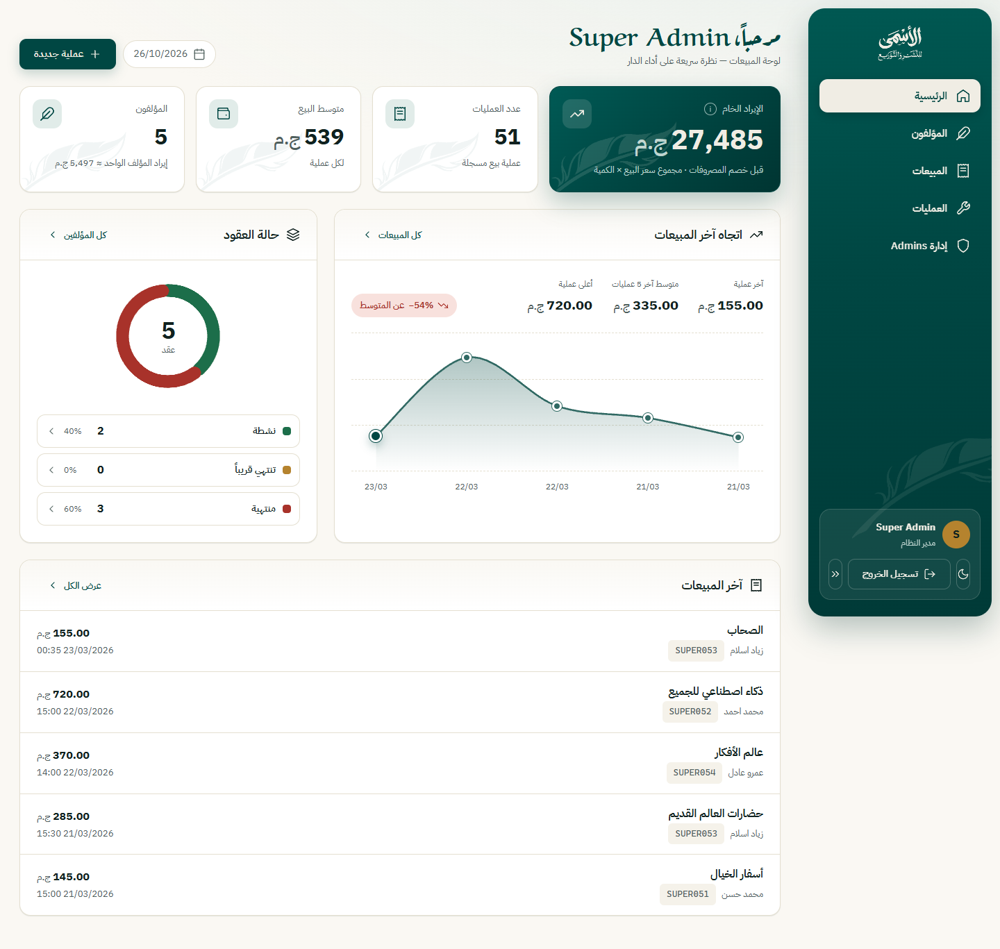

---

## المحتويات

1. [نظرة عامة](#نظرة-عامة)
2. [لقطات من النظام](#لقطات-من-النظام)
3. [المزايا](#المزايا)
4. [الأدوار والصلاحيات](#الأدوار-والصلاحيات)
5. [التقنيات](#التقنيات)
6. [المعمارية وهيكل المشروع](#المعمارية-وهيكل-المشروع)
7. [نموذج البيانات (ERD)](#نموذج-البيانات-erd)
8. [قواعد الحساب](#قواعد-الحساب)
9. [تدفق البيانات والخوارزميات](#تدفق-البيانات-والخوارزميات)
10. [خريطة الصفحات](#خريطة-الصفحات)
11. [التقارير والتصدير](#التقارير-والتصدير)
12. [تصميم الواجهة](#تصميم-الواجهة)
13. [التشغيل](#التشغيل)
14. [الأمان](#الأمان)
15. [خارطة الطريق](#خارطة-الطريق)

---

## نظرة عامة

نظام ويب بواجهة عربية كاملة (RTL) يدير الجانب الإداري والمالي لدار نشر:

- **المؤلفون وعقودهم:** بيانات الحساب، تاريخ العقد، حالة العقد والأيام المتبقية (تُحسب تلقائياً)، والمصروفات الأساسية على المؤلف.
- **المبيعات:** تسجيل كل عملية بيع (الكتاب، المؤلف، المنفذ، السعر، الكمية، مصروف النسخة) مع حساب الصافي في الخادم.
- **العمليات التشغيلية:** مصروفات الطباعة والتصميم والتخزين… مرتبطة بمؤلف/كتاب أو نفقات عامة.
- **اللوحات والتقارير:** لوحة للإدارة، ولوحة شخصية لكل مؤلف بصافي ربحه، وتصدير Word وPDF.
- **صلاحيات بثلاثة أدوار:** `SuperAdmin` و`Admin` و`Author`.

يعمل على الكمبيوتر والتابلت والموبايل من تصميم واحد متجاوب (شريط جانبي ← شريط أيقونات ← شريط سفلي) مع وضع ليلي.

## لقطات من النظام

| تسجيل الدخول | الوضع الليلي |
|:--:|:--:|
| 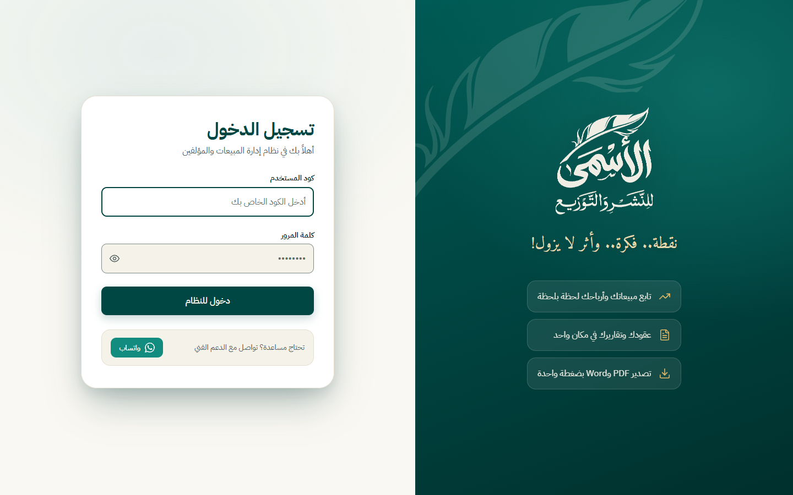 | 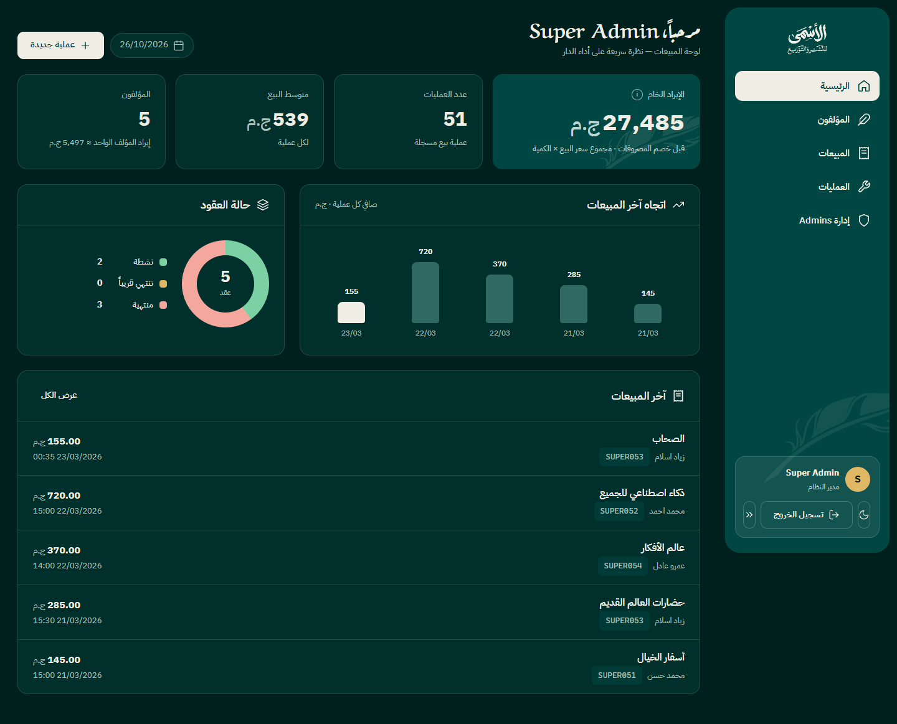 |

| سجل المبيعات | تسجيل عملية (Drawer) |
|:--:|:--:|
| 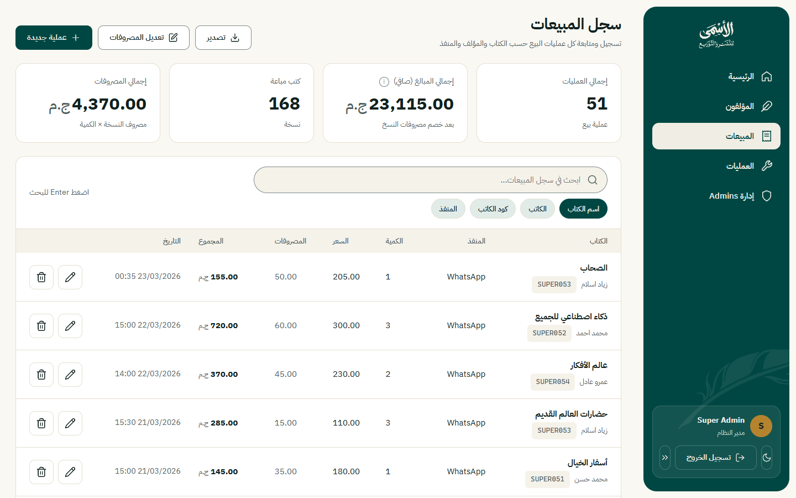 | 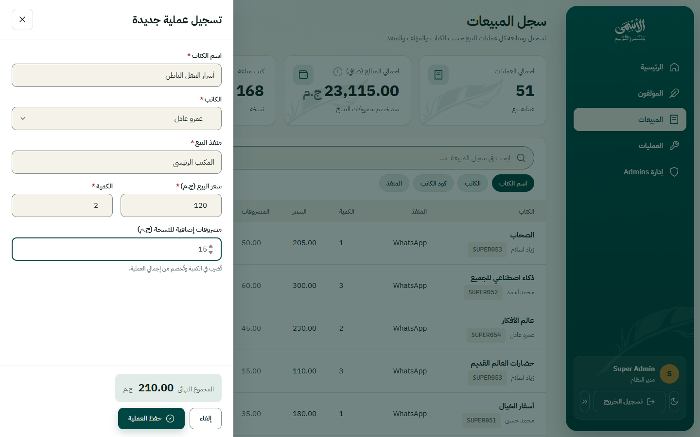 |

| المؤلفون | لوحة المؤلف |
|:--:|:--:|
| 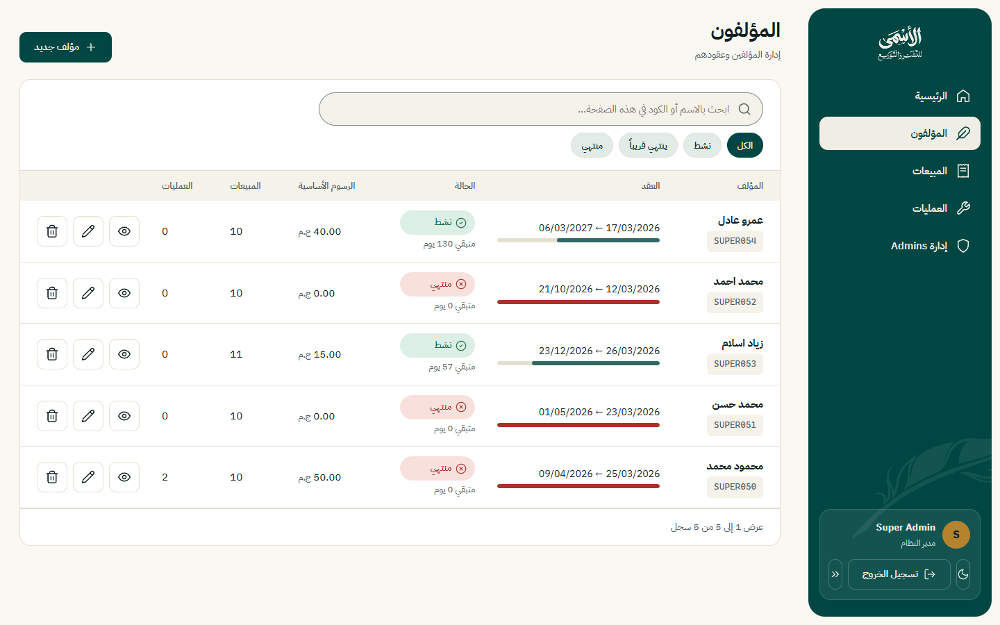 | 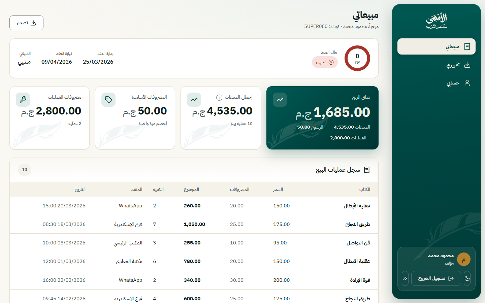 |

| العمليات | التعديل الجماعي للمصروفات |
|:--:|:--:|
| 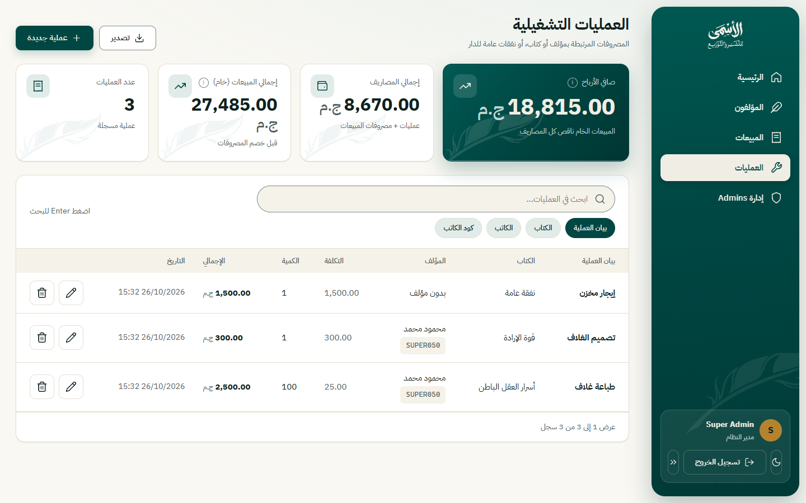 | 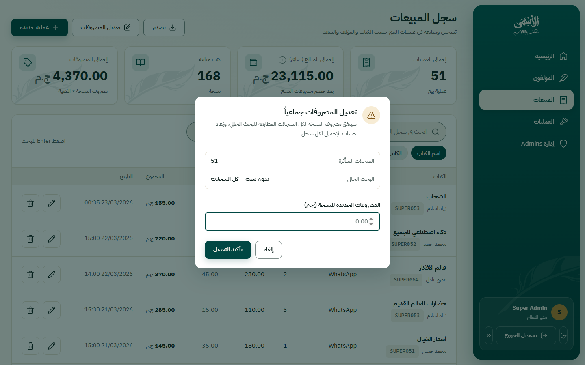 |

**الموبايل والتابلت**

<p align="center">
  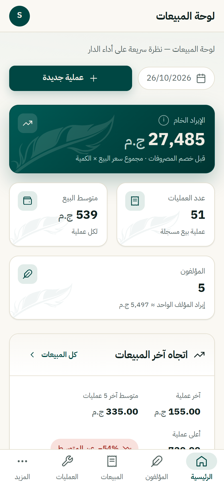
  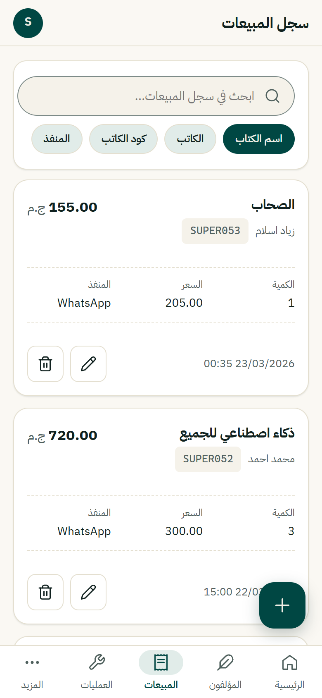
  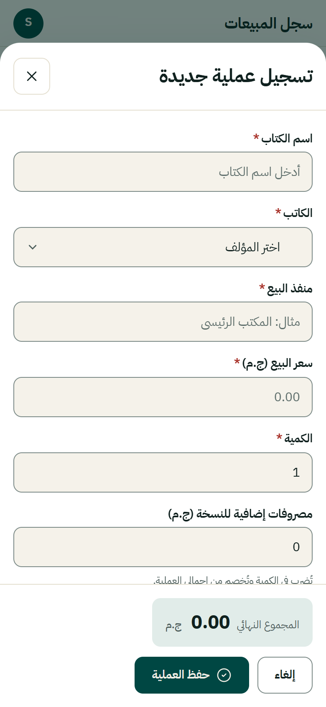
  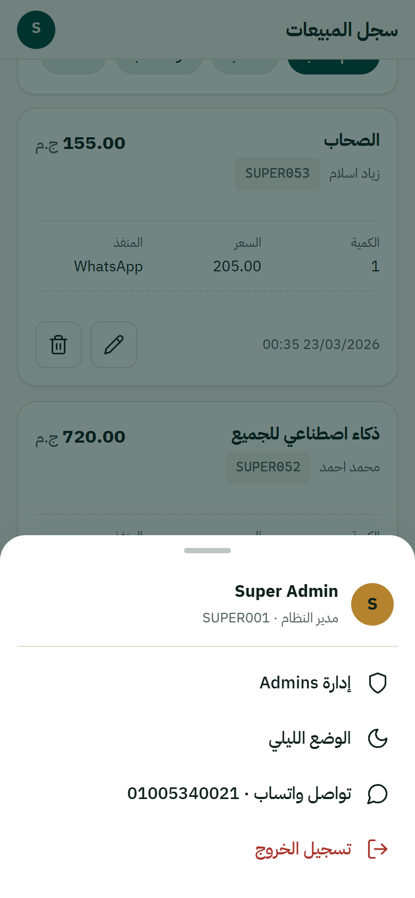
</p>

<p align="center">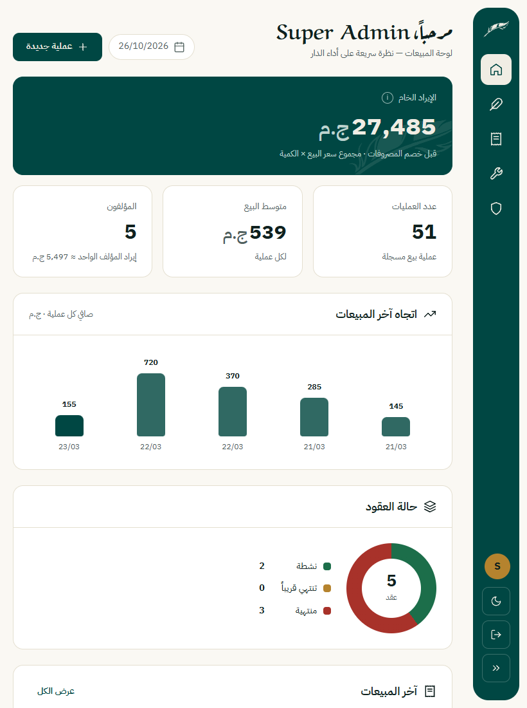</p>

## المزايا

- **المؤلفون:** إضافة/تعديل/حذف ناعم، كود دخول فريد، حالة العقد بأيقونة ولون ونص، شريط تقدم العقد، بحث وتصفية داخل الصفحة.
- **المبيعات:** بحث بأربعة حقول (الكتاب / المؤلف / كود المؤلف / المنفذ) + ترقيم 10 سجلات، كله داخل SQL؛ مؤشرات (عدد العمليات، صافي المبالغ، الكتب المباعة، المصروفات)؛ نموذج جانبي بإجمالي لحظي؛ تعديل جماعي للمصروفات بخطوة تأكيد تعرض عدد السجلات المتأثرة.
- **العمليات:** مصروف مرتبط بمؤلف/كتاب أو نفقة عامة، مؤشرات المصاريف والمبيعات وصافي الأرباح.
- **لوحة الإدارة:** الإيراد الخام، متوسط البيع، العقود (نشطة/قريبة/منتهية) برسم دائري، اتجاه آخر المبيعات، تنبيه بالعقود التي تنتهي قريباً.
- **لوحة المؤلف:** حالة العقد + عداد تنازلي حي، **صافي الربح** كمؤشر رئيسي مع تفصيله، جدولا المبيعات والعمليات بترقيم مستقل.
- **التصدير:** Word وPDF حقيقي (A4 عربي) للمبيعات والعمليات وتقرير كل مؤلف.
- **تجربة الاستخدام:** وضع ليلي يُحفظ، طيّ الشريط الجانبي، إشعارات Toast، تأكيد الحذف في نافذة، حالات فارغة، لمس 44px، تباين WCAG AA، `prefers-reduced-motion`.

## الأدوار والصلاحيات

| القدرة | Author | Admin | SuperAdmin |
|---|:--:|:--:|:--:|
| تسجيل الدخول بالكود | ✅ | ✅ | ✅ |
| لوحته الشخصية + تصدير تقريره | ✅ (نفسه فقط) | — | — |
| لوحة الإدارة | ❌ | ✅ | ✅ |
| عرض المؤلفين وصفحة أي مؤلف وتصدير تقريره | ❌ | ✅ | ✅ |
| إضافة / تعديل / حذف مؤلف | ❌ | ❌ | ✅ |
| المبيعات: عرض + إضافة + تعديل | ❌ | ✅ | ✅ |
| المبيعات: حذف + التعديل الجماعي للمصروفات | ❌ | ❌ | ✅ |
| العمليات: عرض + إضافة + تعديل | ❌ | ✅ | ✅ |
| العمليات: حذف | ❌ | ❌ | ✅ |
| تصدير كل المبيعات / كل العمليات | ❌ | ✅ | ✅ |
| إدارة الـ Admins | ❌ | ❌ | ✅ |

- الـ `SuperAdmin` حساب واحد يُنشأ بالـ Seeder من الإعدادات فقط، ولا توجد واجهة لإنشاء غيره.
- الصلاحيات مفروضة على الخادم بـ `[Authorize(Roles=...)]` على مستوى الـ Controller **والـ Action**، والأزرار تُخفى في الواجهة حسب الدور (الإخفاء للتجربة فقط، الحماية الحقيقية في الخادم).

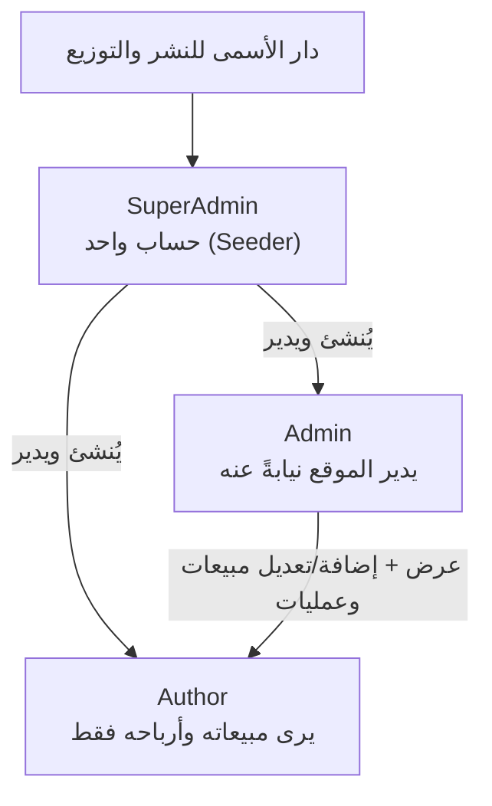

## التقنيات

| الطبقة | التقنية |
|---|---|
| الإطار | ASP.NET Core MVC على **.NET 10** (Areas: `SuperAdmin` / `Admin` / `Author`) |
| البيانات | Entity Framework Core 10 (Code First + Migrations) • SQL Server / LocalDB |
| المصادقة | Cookie Authentication + Claims (بدون ASP.NET Identity) • BCrypt.Net-Next |
| التقارير | QuestPDF (PDF) • HTML → `.doc` (Word) |
| الواجهة | Razor + **CSS خالص** مبني على Design Tokens (بدون Tailwind/Bootstrap) • JavaScript بدون مكتبات • jQuery Validation للنماذج • خط IBM Plex Sans Arabic • أيقونات Lucide مضمّنة (SVG) |
| الأنماط المعمارية | Controller → Service → Repository / Unit of Work → DbContext |

## المعمارية وهيكل المشروع

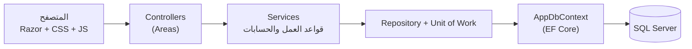

```
AlAsma.Admin/
├─ AlAsma.Admin.slnx
├─ README.md
├─ docs/
│  ├─ design/               مواصفات التصميم (HANDOFF) + Tokens + مراجع HTML
│  └─ images/screenshots/   لقطات الشاشة المستخدمة في هذا الملف
└─ AlAsma.Admin/            المشروع
   ├─ Program.cs            الإعداد: DI، المصادقة، Rate limiting، المسارات
   ├─ Areas/
   │  ├─ SuperAdmin/        إدارة الـ Admins + لوحة المدير الأعلى
   │  ├─ Admin/             المؤلفون • المبيعات • العمليات • لوحة الإدارة
   │  └─ Author/            لوحة المؤلف
   ├─ Controllers/          الدخول والأخطاء
   ├─ Models/               الكيانات: BaseEntity, Author, Sale, Operation
   ├─ Data/                 AppDbContext • Migrations • SuperAdminSeeder
   ├─ DTOs/                 نماذج الإدخال والعرض
   ├─ Interfaces/           عقود الخدمات والمستودعات
   ├─ Services/             Author • Sale • Operation • Dashboard • Export • PdfExport
   ├─ Repositories/         GenericRepository<T> • UnitOfWork
   ├─ UI/                   مساعدات الواجهة: Icon • Navigation • Components
   ├─ Views/Shared/         _Layout + الشريط الجانبي/السفلي + مكونات مشتركة
   └─ wwwroot/              css (design-tokens + app) • js/app.js • images/brand
```

**التطبيق في الواجهة:** صفحة المؤلف نفسها (`_AuthorDashboard`) تُستخدم في لوحة المؤلف وفي صفحة الإدارة `ByAuthor`؛ ونماذج المؤلف/المدير، والبيع، والعملية، وتأكيد الحذف، والترقيم، وبطاقات المؤشرات كلها مكونات مشتركة (Partials) بدل التكرار.

## نموذج البيانات (ERD)

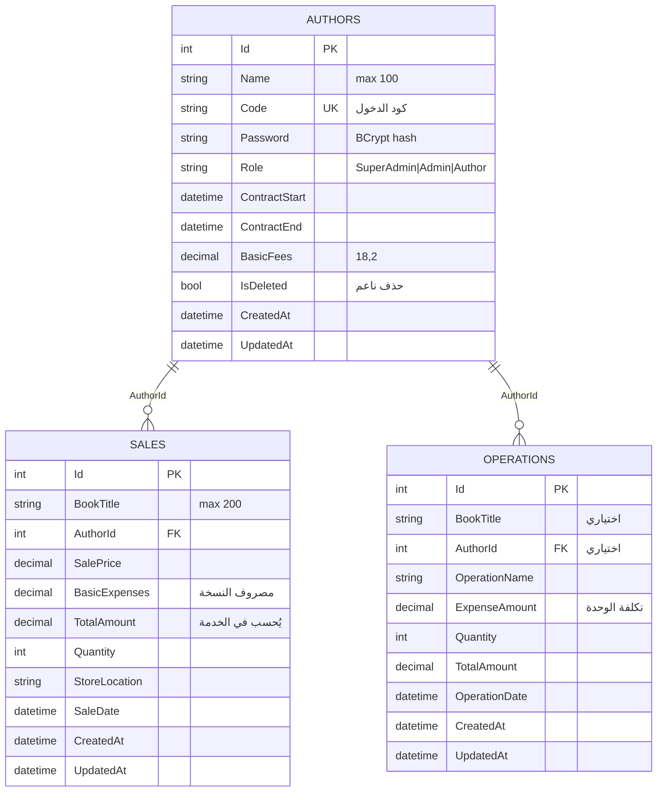

- **كل المستخدمين في جدول `Authors`** والفرق في عمود `Role`.
- **الحذف الناعم** للمؤلفين والمديرين (`IsDeleted` + Global Query Filter)؛ المبيعات والعمليات تُحذف حذفاً نهائياً. كود المؤلف المحذوف لا يُعاد استخدامه (الفهرس الفريد).
- المفاتيح الأجنبية `AuthorId` اختيارية و`OnDelete(Restrict)`؛ مبيعات مؤلف محذوف تظهر «بدون مؤلف».
- كل المبالغ `decimal(18,2)`، وحقول `CreatedAt/UpdatedAt` تُضبط تلقائياً في `SaveChangesAsync`.
- **سكربت T-SQL جاهز:** [`AlAsma.Admin/Data/schema.sql`](AlAsma.Admin/Data/schema.sql) يعمل على قاعدة فاضية أو موجودة دون أخطاء. الـ Migrations تُطبَّق تلقائياً عند التشغيل.

## قواعد الحساب

| الشاشة | المؤشر | المعادلة |
|---|---|---|
| عملية بيع | `TotalAmount` | `max(0, السعر × الكمية − المصروفات × الكمية)` |
| عملية تشغيلية | `TotalAmount` | `التكلفة × الكمية` |
| لوحة الإدارة | الإيراد **الخام** | `Σ (السعر × الكمية)` — قبل خصم المصروفات |
| صفحة المبيعات | إجمالي المبالغ **(صافي)** | `Σ TotalAmount` |
| صفحة المبيعات | إجمالي المصروفات | `Σ (مصروف النسخة × الكمية)` |
| صفحة العمليات | إجمالي المصاريف | `Σ مصاريف العمليات + Σ (مصروف النسخة × الكمية)` |
| صفحة العمليات | صافي الأرباح | `Σ (السعر × الكمية) − إجمالي المصاريف` |
| لوحة المؤلف | **صافي الربح** | `Σ TotalAmount − BasicFees − Σ مصاريف عمليات المؤلف` |
| العقد | الحالة | فارغ ← غير محدد • `≤ 0` يوم ← منتهي • `≤ 20` يوم ← ينتهي قريباً • غير ذلك ← نشط |

> الرقمان **خام** (لوحة الإدارة) و**صافي** (المبيعات) مختلفان عمداً حسب متطلبات الجهة، ويوضّح ذلك تلميح (Tooltip) على المؤشر. ويُقصّ إجمالي العملية عند صفر (`max(0, …)`) حسب المتطلبات.
> تُحسب القيم في الخدمة فقط (`SaleService.CalculateTotal`) والواجهة تعرض القيمة المخزَّنة؛ معاينة النموذج اللحظية بـ JavaScript للعرض فقط.

## تدفق البيانات والخوارزميات

**مخطط السياق (DFD Level 0)**

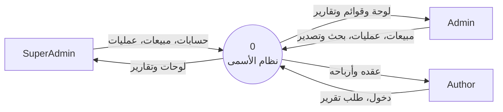

**DFD Level 1**

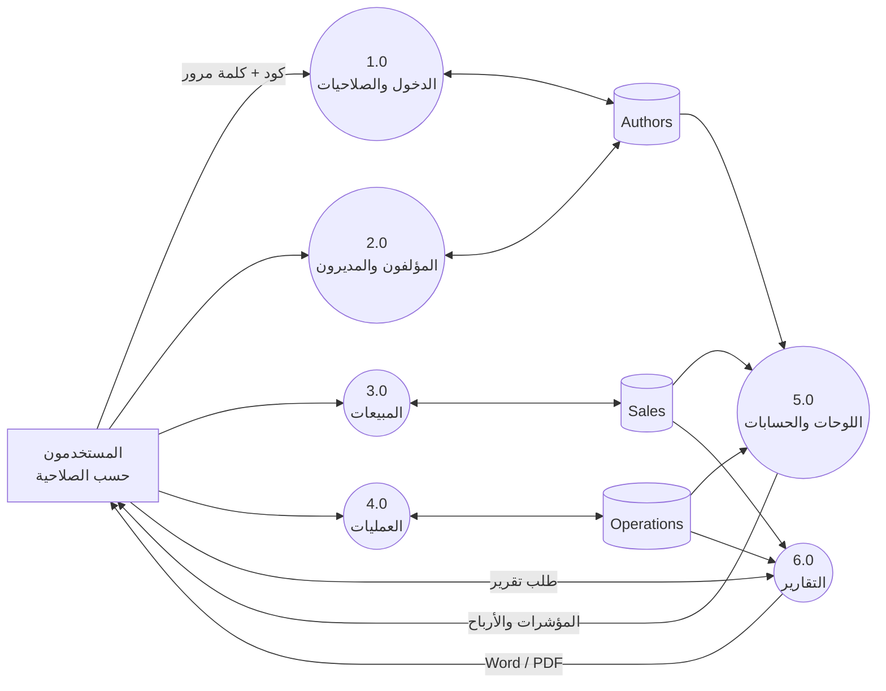

**مسار طلب: تسجيل عملية بيع**

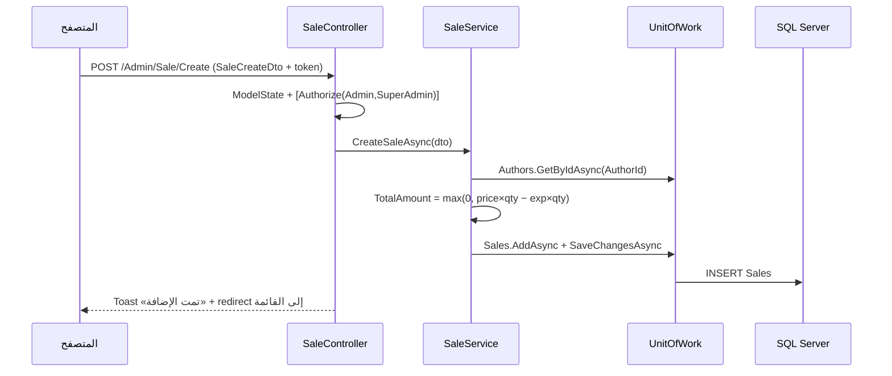

**الدخول**

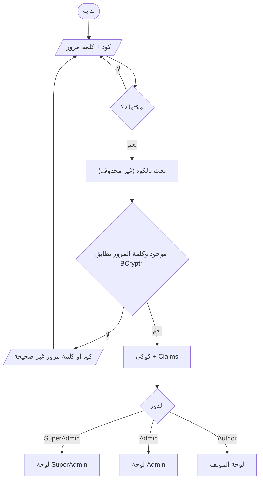

**صافي ربح المؤلف**

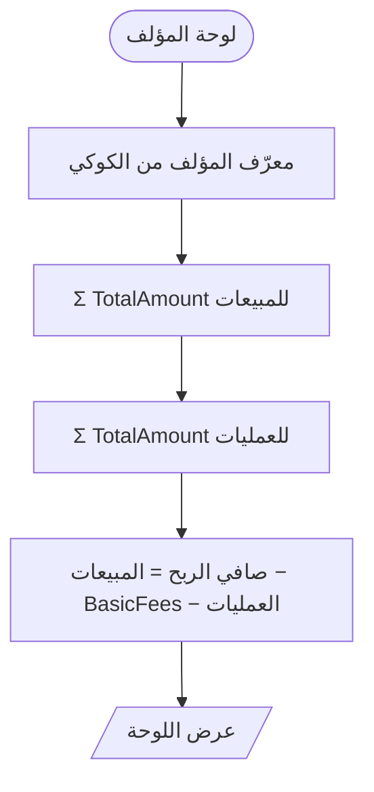

## خريطة الصفحات

| المسار | الصفحة | الدور |
|---|---|---|
| `/` `/Account/Login` | تسجيل الدخول | عام |
| `/SuperAdmin` | لوحة الإدارة (نفس واجهة `/Admin`) | SuperAdmin |
| `/SuperAdmin/AdminManagement` | الـ Admins: قائمة • إضافة • تعديل • حذف | SuperAdmin |
| `/Admin` | لوحة المبيعات | Admin, SuperAdmin |
| `/Admin/Author` | المؤلفون (عرض للـ Admin) • إضافة/تعديل/حذف | Admin عرض • SuperAdmin كامل |
| `/Admin/Sale` | المبيعات + تسجيل + تعديل + تصدير | Admin, SuperAdmin |
| `/Admin/Sale/ByAuthor?authorId=` | صفحة مؤلف للإدارة + تصديره | Admin, SuperAdmin |
| `/Admin/Operation` | العمليات + تسجيل + تعديل + تصدير | Admin, SuperAdmin |
| `/Author` | مبيعاتي (لوحة المؤلف) + تصدير تقريري | Author |
| `/Error/{code}` `/Account/AccessDenied` | صفحات الأخطاء | عام |

الحذف والتعديل الجماعي (`Delete`, `BulkEditExpenses`) والأكشنز الخاصة بإضافة/تعديل/حذف المؤلفين محمية بـ `SuperAdmin` فقط.

## التقارير والتصدير

| التقرير | البيانات | الصيغ |
|---|---|---|
| كل المبيعات | كل سجلات `Sales` | Word • PDF |
| كل العمليات | كل سجلات `Operations` | Word • PDF |
| تقرير مؤلف | مبيعات وعمليات المؤلف + المؤشرات | Word • PDF |

- المؤلف يصدّر تقريره فقط (يُتحقق من `authorId` مقابل هوية الكوكي)، والإدارة تصدّر لأي مؤلف.
- نصوص المستخدم في تقارير Word تُرمَّز (HTML-encoded). تقارير PDF تُبنى بـ QuestPDF (A4، RTL، ترقيم صفحات).
- **الخطوط:** QuestPDF 2026.9 لا تستخدم خطوط النظام تلقائياً، لذا يُفعَّل `UseSystemFonts` (Arial/Tahoma على Windows). على خادم بدون خط عربي ضع ملف الخط في مجلد `Fonts` بجوار التطبيق. ترخيص QuestPDF Community مجاني بشروط (راجعها قبل النشر التجاري).

## تصميم الواجهة

الواجهة مبنية على نظام **Al-Asma Pro** (مشترك مع مشروع المتجر): [`docs/design/HANDOFF.md`](docs/design/HANDOFF.md).

| العنصر | القيمة |
|---|---|
| الألوان | أخضر `#004743` • كريمي `#faf8f3` • نحاسي `#b5832e` (نادراً) • أحمر `#a8322a` للحذف والأخطاء فقط |
| الوضع الليلي | أخضر غامق `#00201e` / `#002f2c` — ليس أسود |
| الخطوط | IBM Plex Sans Arabic (الواجهة) • Aref Ruqaa (الترحيب) • Amiri (الشعار) |
| الأرقام | `tabular-nums`، والعملة بعد الرقم: `27,485 ج.م` |
| نقاط التحول | `< 640` شريط علوي + سفلي • `640–1023` شريط أيقونات • `≥ 1024` شريط جانبي 264px |
| المكونات | زر • حقل • بطاقة مؤشر (عادي/رئيسي) • شارة (لون+أيقونة+نص) • جدول ← بطاقات على الموبايل • ترقيم • Drawer / Bottom sheet • Modal • Toast • حالة فارغة |

- **الملفات:** `wwwroot/css/design-tokens.css` (المتغيرات) + `wwwroot/css/app.css` (المكونات) + `wwwroot/js/app.js` (السلوك). لا ألوان ثابتة داخل الـ Views، والخصائص المنطقية (`inline-start/end`) بدل left/right.
- **القوائم حسب الدور** تُبنى من `UI/Navigation.cs` وتظهر في الشريط الجانبي والشريط السفلي وورقة «المزيد».
- **الأيقونات:** `UI/Icon.cs` → `@Icon.Svg("home")` (SVG مضمّن بـ `currentColor`).

## التشغيل

**المتطلبات:** [.NET 10 SDK](https://dotnet.microsoft.com/download) • SQL Server أو LocalDB • اتصال بالإنترنت لتحميل الخطوط.

```bash
git clone <repo-url>
cd AlAsma.Admin/AlAsma.Admin

# 1) نص الاتصال وبيانات المدير الأعلى (لا تضعها في ملفات تُرفع على GitHub)
dotnet user-secrets set "ConnectionStrings:DefaultConnection" "Server=(localdb)\MSSQLLocalDB;Database=AlAsmaDb;Trusted_Connection=True;TrustServerCertificate=True;MultipleActiveResultSets=True;"
dotnet user-secrets set "SuperAdmin:Name"     "Super Admin"
dotnet user-secrets set "SuperAdmin:Code"     "<كود>"
dotnet user-secrets set "SuperAdmin:Password" "<كلمة مرور قوية>"

# 2) التشغيل — تُطبَّق الـ Migrations ويُنشأ المدير الأعلى تلقائياً
dotnet run
# http://localhost:5133   أو   https://localhost:7165
```

| الإعداد | المفتاح | ملاحظة |
|---|---|---|
| نص الاتصال | `ConnectionStrings:DefaultConnection` | إجباري — يتوقف التطبيق برسالة واضحة إن غاب |
| المدير الأعلى | `SuperAdmin:Name/Code/Password` | يُرفض أي قيمة تشبه الـ placeholder (`YOUR_…`, `CHANGE_ME`) |
| البيئة | `ASPNETCORE_ENVIRONMENT` | `appsettings.Development.json` يضبط LocalDB محلياً |

**أوامر مفيدة**

```bash
dotnet build
dotnet list package --vulnerable --include-transitive   # فحص الثغرات
dotnet ef migrations add <Name> --project AlAsma.Admin  # (الأداة في dotnet-tools.json)
```

## الأمان

**مطبّق:**
- تشفير كلمات المرور بـ BCrypt، ورسالة خطأ موحّدة عند الدخول لا تكشف أيهما الخاطئ.
- **تحديد معدل الدخول:** 8 محاولات في الدقيقة لكل IP ثم `429`.
- **إعادة التحقق من المستخدم في كل طلب:** الحساب المحذوف أو الذي تغيّر دوره يفقد الوصول فوراً.
- سياسة افتراضية «يلزم تسجيل الدخول»، وحماية الأكشنز بالأدوار على الخادم.
- حماية النماذج بـ Anti-Forgery Token، وكوكي `HttpOnly` و`SameSite=Lax`.
- ترويسات `X-Content-Type-Options` و`X-Frame-Options` و`Referrer-Policy`.
- ترميز HTML لبيانات المستخدم في تقارير Word، وفحص مدخلات (Data Annotations) على الخادم والمتصفح.
- فحص دوري للحزم: لا ثغرات معروفة وقت كتابة هذا الملف.

**قبل النشر العام (مهم):**
- ⚠️ لا تُبقِ كلمات سر قواعد البيانات في `appsettings.json`؛ استخدم User Secrets أو متغيرات البيئة أو إعدادات الاستضافة، وغيّر أي كلمة سبق رفعها.
- غيّر كلمة مرور المدير الأعلى الافتراضية، وفعّل HTTPS فقط.
- أضف سياسة `Content-Security-Policy` مناسبة لبيئتك.

## خارطة الطريق

- [ ] كيان «كتاب» مستقل (ISBN، مخزون، غلاف) وربط المبيعات به.
- [ ] مدفوعات المؤلفين (مستحق/مدفوع) ونسبة Royalty.
- [ ] فلاتر بالتاريخ وتقارير شهرية وتصدير Excel.
- [ ] سجل تدقيق (Audit Log) وCSP.
- [ ] اختبارات آلية (Unit / Integration).
- [ ] متجر إلكتروني (سلة، طلبات، دفع).

---

<div align="center">

صُنع لدار **الأسمى للنشر والتوزيع** — *نقطة.. فكرة.. وأثر لا يزول!*

</div>
